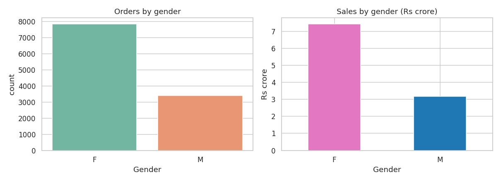
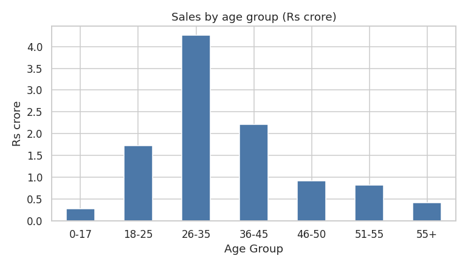
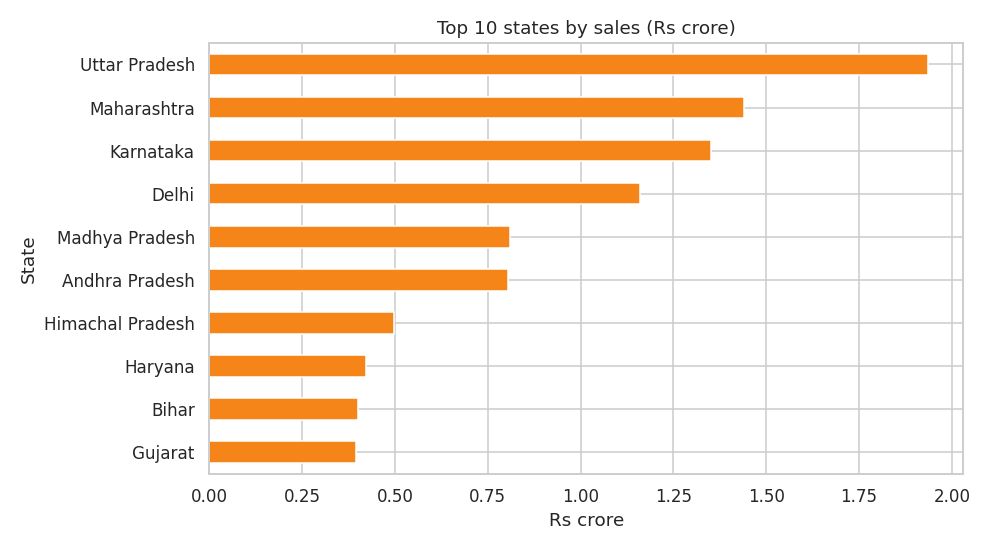
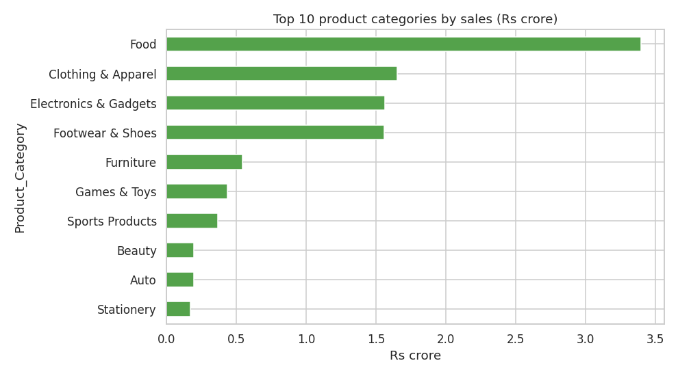
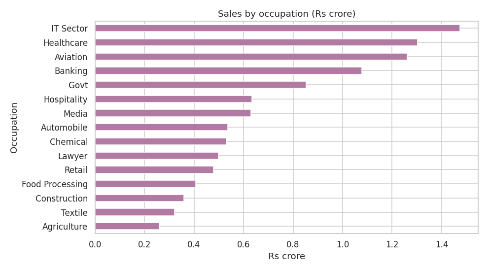
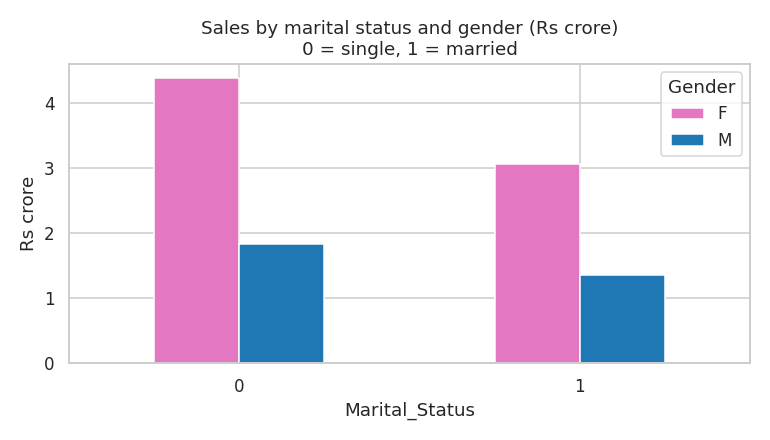

# Diwali Sales Analysis

Exploratory data analysis (EDA) in Python on Diwali retail sales data. Cleans the data, then answers: who buys, where, and what sells the most.

## Tech stack
- Python, Pandas, NumPy
- Matplotlib, Seaborn
- Jupyter Notebook

## Dataset
- File: `data/Diwali_Sales_Data.csv` (11,251 rows, 15 columns)
- Columns include customer gender, age group, marital status, state, zone, occupation, product category, orders, and amount.
- Source: public Kaggle dataset "Diwali Sales Data" (add the exact link here).

## What I did
1. **Inspected** the data: shape, types, missing values.
2. **Cleaned** it: dropped 2 fully empty columns, 12 rows with missing `Amount`, and 8 duplicate rows. Result: **11,231 rows**.
3. **Analysed** sales by gender, age group, state, zone, product category, occupation, and marital status.
4. **Visualised** the results with bar charts.

## Key findings
| Question | Answer |
|---|---|
| Total sales | about **Rs 10.6 crore** |
| Average order amount | Rs 9,454 |
| Who spends most? | Women: **70%** of sales |
| Top age group | **26-35**: 40% of sales |
| Top state | **Uttar Pradesh**: 18%, then Maharashtra (14%) and Karnataka (13%) |
| Top category | **Food**: 32%, then Clothing & Apparel (15.5%) and Electronics (14.7%) |
| Biggest segment | Unmarried women: about 41% of sales |

## Charts







## Project structure
```
diwali-sales-analysis/
├── data/Diwali_Sales_Data.csv
├── notebooks/sales_analysis.ipynb
├── images/
├── requirements.txt
└── README.md
```

## How to run
```bash
git clone https://github.com/noopurrr/diwali-sales-analysis-python-practice.git
cd diwali-sales-analysis-python-practice
pip install -r requirements.txt
jupyter notebook notebooks/sales_analysis.ipynb
```

## What I learned
Data cleaning with Pandas, grouping and aggregating, and turning numbers into simple charts.
